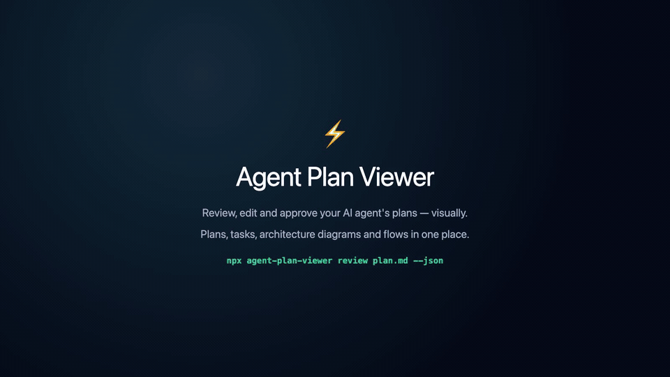

# Agent Plan Viewer ⚡

> An interactive visual viewer and two-way editor for AI agent implementation plans (Claude Code, OpenAI Codex, Antigravity/AGY, Cursor, etc.).

Instead of forcing developers to skim long, static markdown plans in terminal windows, **Agent Plan Viewer** renders plans as an interactive web environment with visual diagram manipulation, request flow stepping, explicit save controls, and bidirectional sync back to the waiting agent.

## Demo

[](./docs/demo/agent-plan-viewer-demo.mp4)

> 🎬 **[Watch full-resolution MP4 video (1600×900)](./docs/demo/agent-plan-viewer-demo.mp4)** — Interactive task checklists, visual diagram editing, request flow simulation, structured diffs, and surgical Mermaid source patching.

---

## Key Features

1. **Interactive Plan & Checklist Inspector**:
   - Turn markdown tasks and checklists into interactive toggles.
   - Inline edit task descriptions, reorder milestones, and add new tasks.
   - Filter and inspect impacted files (`[NEW]`, `[MODIFY]`, `[DELETE]`).
   - Add inline feedback notes and instructions for the agent.

2. **Visual Diagram Canvas (React Flow)**:
   - Converts Mermaid syntax (`flowchart TD/LR`, `sequenceDiagram`) into an interactive visual canvas.
   - Drag and drop components to rearrange architecture layout.
   - Add new services, databases, queues, gateways, and actors via the toolbar.
   - Connect and rewire components with handle dragging.
   - Two-way synchronization: visual canvas edits automatically serialize back to clean Mermaid markdown upon save/approval.

3. **Phase 2: Request Flow Simulator**:
   - Trace system execution and workflow sequences step-by-step.
   - Play/pause/step controls with adjustable playback speeds (`0.5x`, `1x`, `2x`).
   - Animated traveling packet pulses along active edges.
   - Step inspector HUD showing mock request payloads, expected responses, and failure mode verifications.

4. **Two-Tier History Engine (Depth 10)**:
   - **Tier 1 (Action Undo/Redo)**: In-memory history tracking up to 10 discrete keystrokes, node drags, and task toggles (`⌘Z` / `⌘⇧Z`).
   - **Tier 2 (Saved Baseline Checkpoints)**: Whenever the user explicitly clicks **"Save Draft"**, a persistent baseline snapshot is captured (capped at 10 versions). A dedicated "Saved Baselines" drawer lets developers inspect and revert to any of the last 10 baselines.
   - **No Autosave on Movement**: Plans on disk are never modified during editing until the user explicitly hits **"Save Draft"** or **"Approve & Submit"**.

5. **Agent Skill & Blocking Review Protocol**:
   - Packaged as an **Agent Skill (`skills/agent-plan-viewer/SKILL.md`)** compatible with Claude Code, Cursor, Codex, and Antigravity.
   - Blocks agent execution until the human user resolves the review session in the browser, returning structured approval status, diffs, and instructions to `stdout`.

---

## Quick Start

### 1. Installation
```bash
npm install
npm run build
```

### 2. Reviewing a Plan
```bash
# Review an existing plan (blocks until approved or revised)
./bin/cli.js review ./examples/sample-plans/e-commerce-microservices.md

# Output JSON result upon completion (ideal for agents)
./bin/cli.js review ./examples/sample-plans/e-commerce-microservices.md --json
```

---

## Agent Integration (Skill)

Agent Plan Viewer can be installed as an autonomous skill across **Google Antigravity (AGY)**, **Claude Code**, **Cursor**, **Codex**, and custom pipelines with a single command:

```bash
# Install into the current workspace (.agents/skills, .claude/skills, .cursor/rules, AGENTS.md, CLAUDE.md)
npx github:ppopli/agent-plan-viewer install-skill

# Or install globally across your machine
npx github:ppopli/agent-plan-viewer install-skill --global
```

👉 **See the complete installation guide: [`skills/agent-plan-viewer/README.md`](./skills/agent-plan-viewer/README.md)**

### How It Works:
1. Run `npx github:ppopli/agent-plan-viewer install-skill` (or copy [`skills/agent-plan-viewer/SKILL.md`](./skills/agent-plan-viewer/SKILL.md) into `.agents/skills/agent-plan-viewer/` or `.claude/skills/agent-plan-viewer/`).
2. When the agent finishes planning, it runs:
   ```bash
   npx agent-plan-viewer review <path-to-plan.md> --json
   ```
3. The agent awaits user approval, parses the returned JSON diff and user instructions, and proceeds autonomously with the approved architecture!

---

## Diagram Editing & Markdown Preservation

When you edit a Mermaid diagram in the viewer, only the lines you changed are rewritten in your original markdown (`flowchart`/`graph`, `sequenceDiagram`, and `erDiagram`). Everything else in the diagram — `subgraph` groups, `alt` / `else` / `opt` blocks, notes, comments, `style` / `classDef` lines, entity attribute blocks, indentation and line endings — is left byte-for-byte intact:

- **Subgraph-aware placement:** New flowchart nodes join the `subgraph` of the node they connect to, with matching indentation (unconnected nodes are appended at the end).
- **Order preservation:** Re-ordering edges, sequence messages, participants, or ER relationships is saved by permuting only the statement text across existing line slots without moving surrounding blocks.
- **Multi-statement lines:** Lines like `A --> B; B --> C` are split only when an edit touches that line, leaving untouched lines intact.
- **Self-verified patching:** After patching, the result is re-parsed and compared against your edited graph. Diagrams you didn't touch are never rewritten, and a save with no edits leaves the file byte-identical.

### Known Limitations

- **Unsupported diagram types are read-only.** Mermaid types beyond flowcharts, sequence diagrams, and ER diagrams (`classDiagram`, `stateDiagram`, `gantt`, ...) render for review and remain untouched on save, but cannot be edited in the canvas.
- **Creating new `alt` / `opt` / `loop` blocks or `subgraph` groups** must be done in markdown (existing blocks and messages inside them can be edited in the canvas).
- **ER entities with attribute blocks** display a compact attribute summary in their node label, so renaming those entity headers must be done in markdown (plain entities without attribute blocks can be renamed in the canvas).
- **Unconnected new nodes** in a flowchart have no neighbor to infer a `subgraph` from and are appended at the end of the diagram.
- **Fallback on unpatchable flowchart/sequence edits:** If an edit cannot be patched and verified safely, that diagram falls back to regenerating from the graph model (for `erDiagram`, the original source is kept instead so it never turns into a flowchart).

---

## Testing

```bash
# Run Unit & Integration Tests (87 tests)
npm test

# Run End-to-End Lifecycle Tests
npm run test:e2e
```

---

## Documentation
- [`context/INDEX.md`](./context/INDEX.md): Index for AI agents and developers.
- [`context/DESIGN.md`](./context/DESIGN.md): Architectural decisions and Two-Tier History Engine specs.
- [`context/SPEC.md`](./context/SPEC.md): REST/WebSocket APIs, Graph schemas, and CLI protocols.
