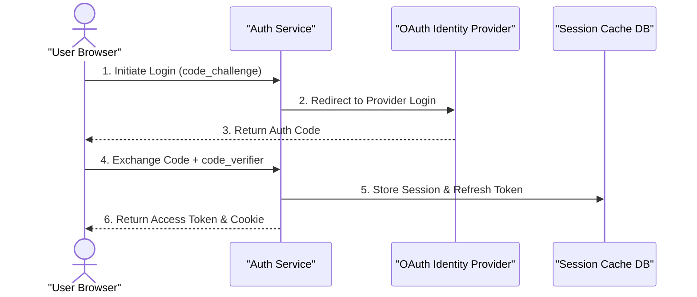

# Implementation Plan: OAuth2 Authorization Code Flow with PKCE

Integrate secure user login supporting PKCE, token refresh rotation, and Redis session caching.

## Architecture & Sequence Flow

## Tasks
- [ ] Implement code_verifier generation and SHA-256 challenge hash
- [ ] Add state parameter verification against CSRF attacks
- [ ] Implement refresh token rotation mechanism
- [ ] Add Redis TTL expiration on active session keys

## Proposed File Changes
#### [NEW] src/auth/pkce.ts
#### [NEW] src/auth/oauth-handler.ts
#### [MODIFY] src/middleware/session.ts
