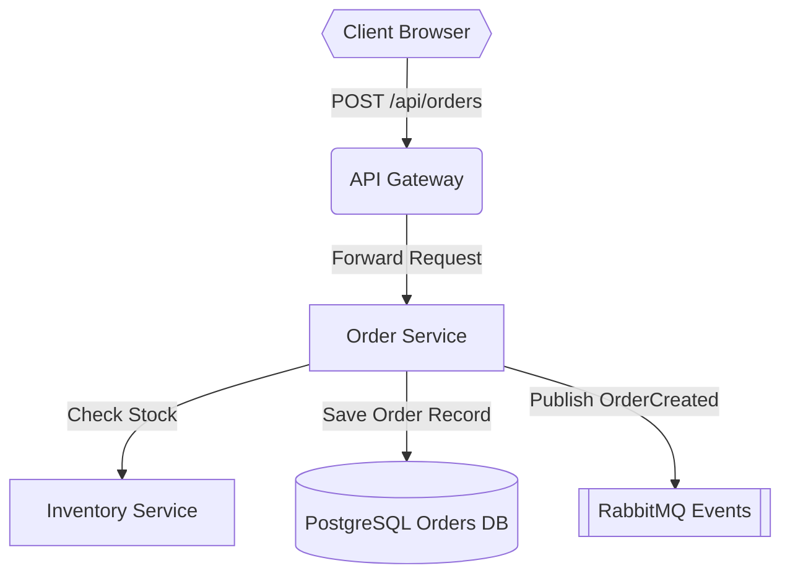

# Implementation Plan: E-Commerce Order Processing Architecture

Implement a resilient distributed order placement pipeline connecting the Client, Ingress Gateway, Order Service, Inventory Service, PostgreSQL DB, and RabbitMQ event stream.

## Goal Description
Provide end-to-end checkout with atomic order creation, automated inventory reservation, and asynchronous fulfillment dispatch via event queues.



## Tasks & Milestones
- [ ] Implement JWT authentication filter in API Gateway
- [ ] Add idempotency key validation in Order Service
- [ ] Configure database transaction isolation level in PostgreSQL
- [ ] Create orders and order_items relational tables with foreign keys
- [ ] Add RabbitMQ exchange bindings and dead-letter queue (DLQ)
- [ ] Implement Redis distributed locks for inventory stock reservation
- [ ] Write integration test verifying atomic rollback on stock exhaustion
- [ ] Deploy health-check probes and telemetry metrics to Prometheus

## Database Schema & Entity Definitions
```sql
CREATE TABLE orders (
    id UUID PRIMARY KEY DEFAULT gen_random_uuid(),
    customer_id UUID NOT NULL,
    total_amount NUMERIC(12, 2) NOT NULL,
    status VARCHAR(32) NOT NULL DEFAULT 'PENDING',
    idempotency_key VARCHAR(128) UNIQUE NOT NULL,
    created_at TIMESTAMP WITH TIME ZONE DEFAULT NOW(),
    updated_at TIMESTAMP WITH TIME ZONE DEFAULT NOW()
);

CREATE TABLE order_items (
    id UUID PRIMARY KEY DEFAULT gen_random_uuid(),
    order_id UUID REFERENCES orders(id) ON DELETE CASCADE,
    sku VARCHAR(64) NOT NULL,
    quantity INTEGER NOT NULL CHECK (quantity > 0),
    unit_price NUMERIC(10, 2) NOT NULL
);

CREATE TABLE inventory_reservations (
    id UUID PRIMARY KEY DEFAULT gen_random_uuid(),
    order_id UUID REFERENCES orders(id),
    sku VARCHAR(64) NOT NULL,
    reserved_quantity INTEGER NOT NULL,
    expires_at TIMESTAMP WITH TIME ZONE NOT NULL
);
```

## Proposed File Changes
#### [NEW] src/services/order.service.ts
#### [NEW] src/services/inventory.service.ts
#### [NEW] db/migrations/001_create_orders_schema.sql
#### [MODIFY] src/gateway/routes.ts
#### [MODIFY] src/config/database.ts
#### [NEW] src/events/publisher.ts
#### [MODIFY] src/events/consumer.ts

## Verification Plan
1. Send checkout request with invalid token: assert 401 Unauthorized.
2. Send checkout request with out-of-stock item: assert 409 Conflict and no DB records created.
3. Send valid checkout: assert 201 Created and OrderCreated event published to RabbitMQ.
