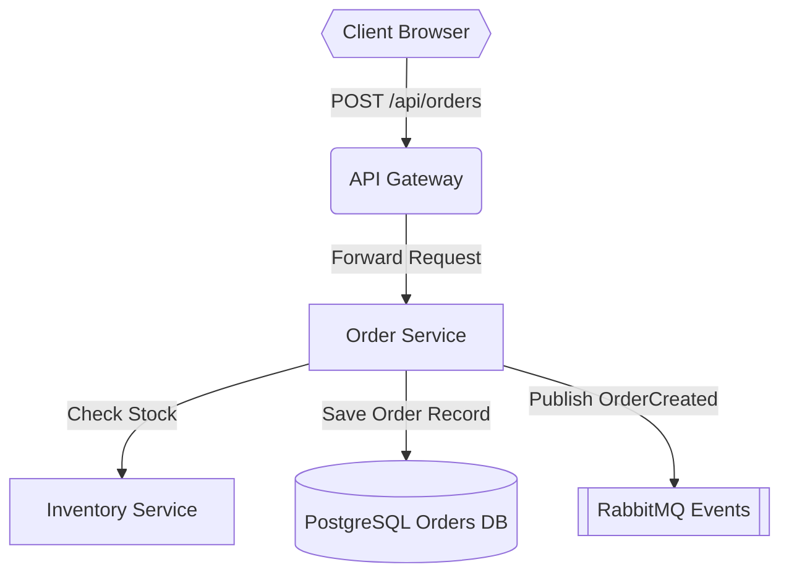

# Implementation Plan: E-Commerce Order Processing Architecture

Implement a resilient distributed order placement pipeline connecting the Client, Ingress Gateway, Order Service, Inventory Service, PostgreSQL DB, and RabbitMQ event stream.

## Goal Description
Provide end-to-end checkout with atomic order creation, automated inventory reservation, and asynchronous fulfillment dispatch via event queues.

## Tasks & Milestones
- [ ] Implement JWT authentication filter in API Gateway
- [ ] Add idempotency key validation in Order Service
- [ ] Configure database transaction isolation level in PostgreSQL
- [ ] Add RabbitMQ exchange bindings and dead-letter queue
- [ ] Write integration test verifying atomic rollback on stock exhaustion

## Proposed File Changes
#### [NEW] src/services/order.service.ts
#### [NEW] src/services/inventory.service.ts
#### [MODIFY] src/gateway/routes.ts
#### [MODIFY] src/config/database.ts
#### [NEW] src/events/publisher.ts

## Verification Plan
1. Send checkout request with invalid token: assert 401 Unauthorized.
2. Send checkout request with out-of-stock item: assert 409 Conflict and no DB records created.
3. Send valid checkout: assert 201 Created and OrderCreated event published to RabbitMQ.
